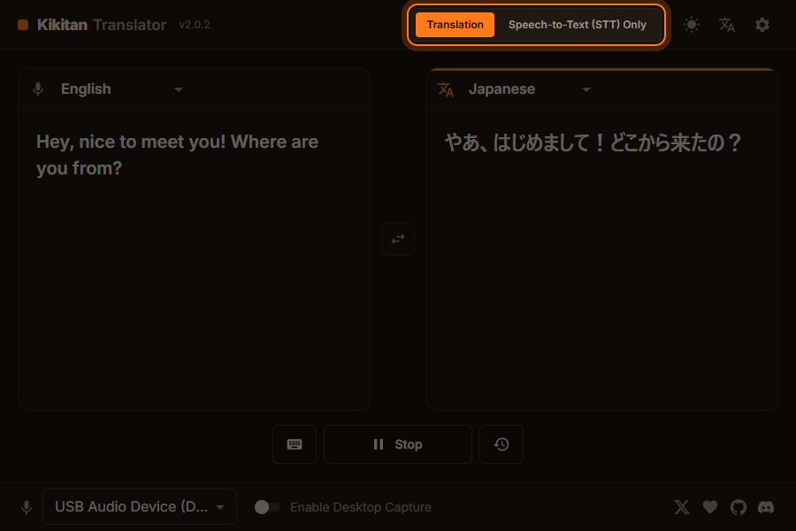
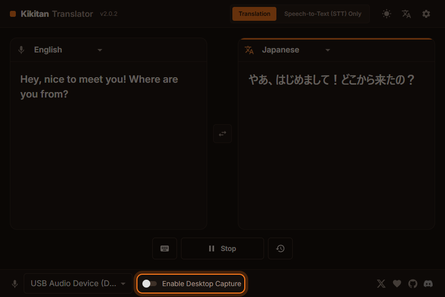
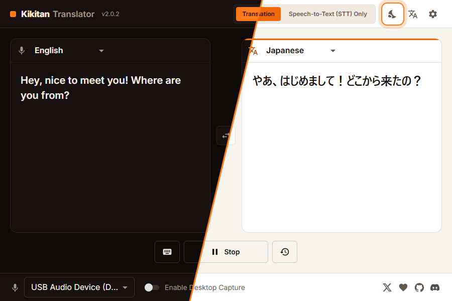
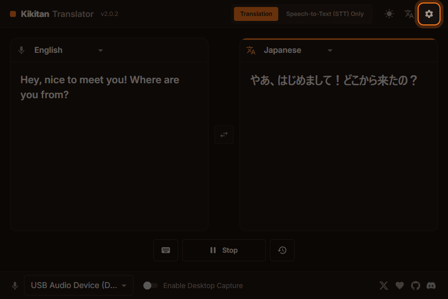

<div align="center">

# 🎙️ Kikitan Translator

**Real-time voice translation for VRChat**

Transcribes and translates what you say on the spot, and shows it in the VRChat chatbox.<br>
Talk with people from all over the world without worrying about the language barrier.

[日本語](README.md) ・ **English**

[](https://github.com/KBYSHanahira/kikitan-translator/archive/refs/heads/main.zip)


[](LICENSE.md)



</div>

---

## 📑 Contents

- [✨ Features](#-features)
- [💻 Requirements](#-requirements)
- [📥 Download and install](#-download-and-install)
- [🚀 How to use](#-how-to-use)
- [⚙️ Settings](#️-settings)
- [❓ FAQ and troubleshooting](#-faq-and-troubleshooting)
- [🛠️ For developers](#️-for-developers)
- [🙏 Credits](#-credits)
- [📄 License](#-license)

---

## ✨ Features

| | Feature | What it does |
|:-:|---|---|
| 🌐 | **Translation** | Translates your speech and shows it in the chatbox. **27 input languages** and **more than 50 output languages**. |
| 📝 | **Speech-to-Text (STT) only** | Sends what you say to the chatbox without translating it. Great if you prefer not to use your voice in VRChat. |
| 🖥️ | **Desktop audio translation** | Translates other people's voices (audio playing on your PC) and shows them as subtitles at the bottom of the screen or in a VR overlay (Windows only). |
| 🔇 | **Mute sync** | Automatically pauses Kikitan while your VRChat microphone is muted. |
| ⌨️ | **Manual input** | Type a sentence with the keyboard to translate and send it. |
| 🎨 | **Light / dark theme** | Switch the look to whichever you prefer. |

**Input languages (27):**
Arabic, Chinese, Czech, Dutch, English, Finnish, French, German, Hungarian, Indonesian, Italian, Japanese, Korean, Norwegian, Polish, Portuguese, Romanian, Russian, Spanish (Argentina, Chile, Mexico, Peru, Spain, US), Swedish, Thai, Turkish

**App languages:** English · 日本語 · 中文 · 한국어

### Recognition and translation engines

| Type | Engine | API key |
|---|---|---|
| Speech recognition | **Microsoft Bing** (default) | Not needed |
| Speech recognition | Groq | Free API key required |
| Speech recognition | Gemini | Free API key required |
| Translation | **Google Translate** (default) | Not needed |
| Translation | Groq / Gemini | Free API key required |

With the default combination (Bing + Google Translate) you can **start right away, no API key needed.**

---

## 💻 Requirements

| Item | Needed |
|---|---|
| OS | Windows 10 / 11 (64-bit) |
| Internet | Required (recognition and translation run online) |
| Microphone | Any microphone connected to your PC |
| VRChat | OSC enabled ([how to](#1-enable-osc-in-vrchat)) |

> [!NOTE]
> Node.js, the .NET 9 SDK and WebView2 are **set up automatically** on the first start. You don't need to install them yourself.

---

## 📥 Download and install

### Option A: Download the ZIP (recommended)

1. **[Click here to download the ZIP](https://github.com/KBYSHanahira/kikitan-translator/archive/refs/heads/main.zip)**.
2. Right-click the downloaded ZIP → **Properties** → tick **Unblock** at the bottom → **OK**.
   (Without this, Windows may show a security warning when you start the app.)
3. Extract the ZIP anywhere you like (for example `C:\Kikitan`).
4. Double-click **`StartTranslator.bat`** in the extracted folder.

### Option B: Download with Git

```sh
git clone https://github.com/KBYSHanahira/kikitan-translator.git
cd kikitan-translator
StartTranslator.bat
```

### About the first start

The first start **takes a few minutes** while everything is prepared automatically.

```
 Kikitan Translator
 ------------------

[1/5] Checking Node.js...          ← downloaded into .tools if missing
[2/5] Checking .NET 9 SDK...       ← downloaded into .tools if missing (about 250 MB, first time only)
[3/5] Checking WebView2 Runtime... ← installed with Microsoft's official installer only if missing
[4/5] Preparing the user interface...
[5/5] Starting Kikitan Translator...
      Building the app ...         ← build (a few minutes, first time only)
```

- Downloaded tools are kept in the `.tools` folder, and **nothing is installed system-wide** (no admin rights needed).
- When everything is ready, **only the Kikitan Translator window opens** and the black console window closes by itself.
- After that, the app starts right away (it is rebuilt automatically only when the source code changes).

---

## 🚀 How to use

### 1. Enable OSC in VRChat

Start VRChat and turn on **Action Menu → Options → OSC → Enabled**.
Kikitan uses OSC to send text to the chatbox.

### 2. Choose your microphone and languages


| Where | What to do |
|---|---|
| Microphone box (bottom left) | Choose the microphone to use |
| Left panel (🎙️) | Choose **the language you speak** |
| Right panel (文A) | Choose **the language to translate into** |
| ⇄ button in the middle | Swap the two languages |
| Switch at the top | Choose **Translation** or **Speech-to-Text (STT) Only** |

### 3. Start and speak

Press **Start** at the bottom and speak into your microphone.

1. What you say appears in the left panel in real time.
2. The translation appears in the right panel.
3. It is also sent to the VRChat chatbox at the same time.

Press **Stop** to stop.

| Button | What it does |
|---|---|
| ⌨️ (keyboard) | Type a sentence to translate and send |
| 🕘 (history) | Show the translations since the app was started |

### 4. Translate other people's voices (desktop capture)



Turn on **Enable Desktop Capture** at the bottom to translate voices playing on your PC and show them as subtitles.

- Without VR: shown at the bottom of your main monitor.
- In VR: shown below the center of your view.

> [!TIP]
> Other people's voices are recognized as **the right panel's language** and translated into **the left panel's language**.

### 5. Change the look



| Button (top right) | What it does |
|---|---|
| ☀️ / 🌙 | Switch between the light and dark theme |
| 文A | Change the app language (English · 日本語 · 中文 · 한국어) |
| ⚙️ | Open the settings |

---

## ⚙️ Settings



Open the settings with ⚙️ in the top right.

### Translator settings

| Setting | What it does |
|---|---|
| Speech Recognition Service | Microsoft Bing (default) / Groq / Gemini |
| Translation Service | Google Translate (default) / Groq / Gemini |
| API Key | Needed for Groq and Gemini (use "Get API Key" to create one for free) |

### VRChat settings

| Setting | What it does |
|---|---|
| Disable Kikitan when muted in game | Your voice is not recognized while you are muted in VRChat |
| Do not send the original text to the chatbox | Only the translation is sent |
| Send to Chatbox/Overlay without waiting | Sends text while you are still speaking, instead of waiting for the final result |
| Chatbox update speed | Slow / Medium / Fast |
| OSC Port | Port to send to (default: `9000`) |

### Advanced settings

| Setting | What it does |
|---|---|
| Send speech recognition and translation data as OSC messages | Sends recognition and translation results to port `7272` for other tools |
| Open Logs | Opens the log folder |

---

## ❓ FAQ and troubleshooting

<details>
<summary><b>Nothing appears in the chatbox</b></summary>

- Make sure **OSC is enabled** in VRChat (Action Menu → Options → OSC → Enabled).
- Make sure the **OSC Port** in the settings is `9000`.
- If "Disable Kikitan when muted in game" is on, Kikitan does nothing while you are muted.

</details>

<details>
<summary><b>My voice is not recognized</b></summary>

- Check that the right microphone is selected in the box at the bottom left.
- In Windows, open **Settings → Privacy & security → Microphone** and make sure desktop apps are allowed to use the microphone.
- Some microphones don't support mono recording; Kikitan records them in stereo automatically.

</details>

<details>
<summary><b>"Windows protected your PC" appears when starting</b></summary>

Before extracting the ZIP, tick **Unblock** in the ZIP's properties, then extract it again.
Or choose **More info → Run anyway** on that screen.

</details>

<details>
<summary><b>Starting takes a long time</b></summary>

The first start, and the first start after the source code changes, build the app and take a few minutes. After that the app starts right away.

</details>

<details>
<summary><b>"You have reached the limit for this service" appears</b></summary>

You have probably hit the free-tier limit. Switch to a different recognition or translation service in the settings, or wait until the limit resets.

</details>

### File locations

| What | Where |
|---|---|
| Logs | `%APPDATA%\Kikitan Translator\logs` |
| Settings file | `%APPDATA%\Kikitan Translator\config.json` |

To report a problem, please open an [issue](https://github.com/KBYSHanahira/kikitan-translator/issues) and attach your log file.

---

## 🛠️ For developers

<details>
<summary><b>Developer mode (hot reload)</b></summary>

```bat
StartTranslator.bat dev
```

Runs the UI on the Vite dev server (with hot reload) and starts the app as a Debug build.
In this mode the dev server and the app console also open their own windows.

</details>

<details>
<summary><b>Building manually</b></summary>

```sh
cd KikitanTranslator.Photino
dotnet build -c Release -p:SkipVelopack=true
```

The output goes to `KikitanTranslator.Photino/bin/Release/net9.0/win-x64/`.
Without `-p:SkipVelopack=true`, the build also creates the installer for distribution (this requires the `vpk` command from [Velopack](https://velopack.io)).

To debug the WebView2 page, start the app with the environment variable `KIKITAN_WEBVIEW2_ARGS=--remote-debugging-port=9222`, then connect DevTools to `http://localhost:9222`.

</details>

<details>
<summary><b>Project layout</b></summary>

| Folder | Contents |
|---|---|
| `KikitanTranslator.Photino` | The app (Photino) and its UI (React + Vite, in `UserInterface/`) |
| `KikitanTranslator.Base` | Audio capture, speech recognition, translation, OSC output |
| `KikitanTranslator.Overlay` | Subtitle overlay for the desktop and VR |
| `KikitanTranslator.Resources` | Localized resources |
| `scripts` | Helper files for the launcher |

</details>

---

## 🙏 Credits

This project is based on [Kikitan Translator](https://github.com/YusufOzmen01/kikitan-translator) by SergioMarquina ([YusufOzmen01](https://github.com/YusufOzmen01)), with improvements on top.
Many thanks for publishing such a great app.

---

## 📄 License

This project is released under the **[MIT License](LICENSE.md)**.

- ✅ You may use, modify and redistribute it freely, for personal or commercial use.
- 📌 When redistributing, include the copyright notice and the license text.
- ⚠️ The software is provided "as is", without any warranty.

See [LICENSE.md](LICENSE.md) for the full text.

<div align="center">
<br>

Made with ❤️ for the VRChat community

</div>
