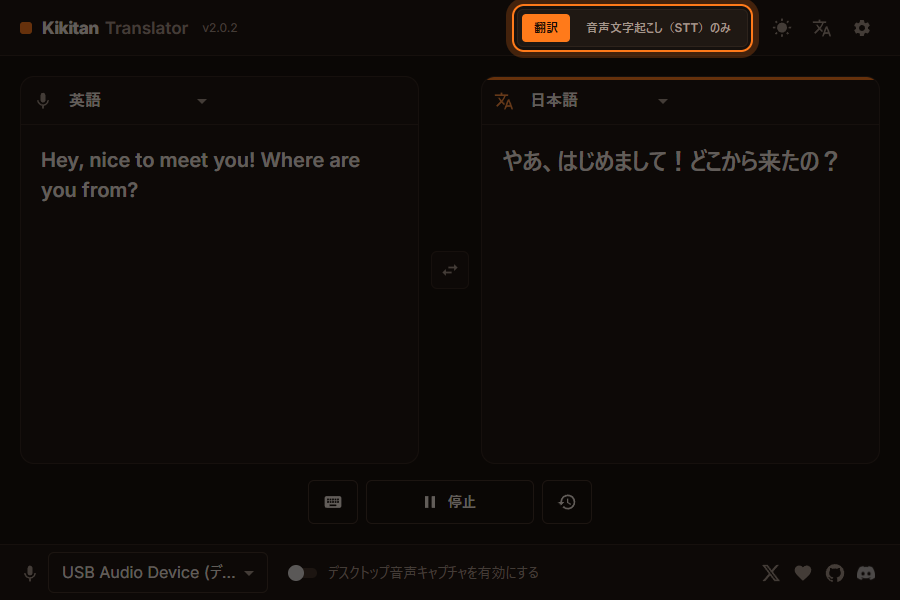
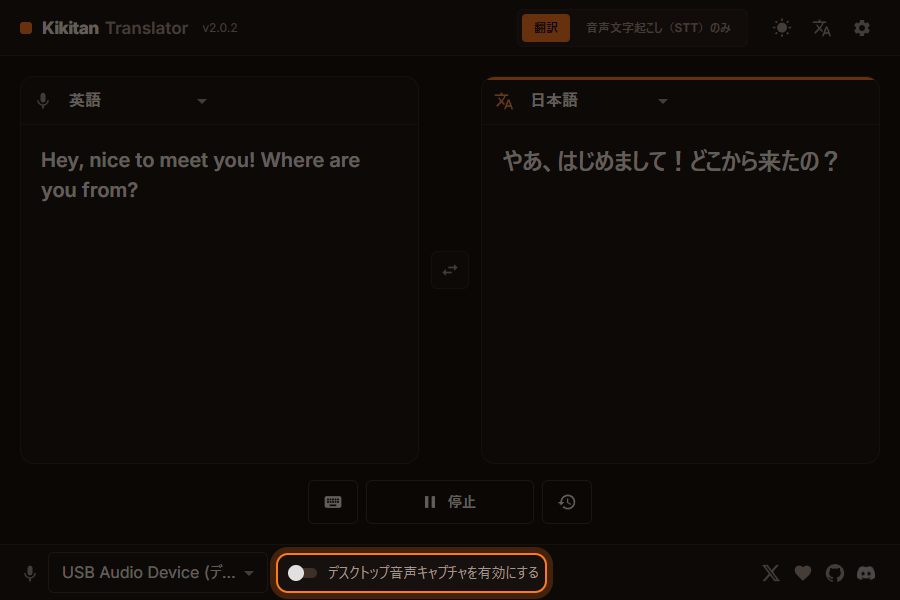

<div align="center">

# 🎙️ Kikitan Translator

**VRChat のための、リアルタイム音声翻訳ツール**

話した言葉をその場で文字起こし・翻訳して、VRChat のチャットボックスに表示します。<br>
言葉の壁を気にせず、世界中の人と会話を楽しみましょう。

**日本語** ・ [English](README.en.md)

[](https://github.com/KBYSHanahira/kikitan-translator/archive/refs/heads/main.zip)


[](LICENSE.md)



</div>

---

## 📑 目次

- [✨ 主な機能](#-主な機能)
- [💻 動作環境](#-動作環境)
- [📥 ダウンロードとインストール](#-ダウンロードとインストール)
- [🚀 使い方](#-使い方)
- [⚙️ 設定](#️-設定)
- [❓ よくある質問・トラブルシューティング](#-よくある質問トラブルシューティング)
- [🛠️ 開発者向け](#️-開発者向け)
- [🙏 クレジット](#-クレジット)
- [📄 ライセンス](#-ライセンス)

---

## ✨ 主な機能

| | 機能 | 内容 |
|:-:|---|---|
| 🌐 | **翻訳** | 話した内容を翻訳してチャットボックスに表示します。入力 **27 言語**、出力 **50 以上の言語**に対応しています。 |
| 📝 | **音声文字起こし（STT）のみ** | 翻訳せずに、話した内容をそのままチャットボックスに送ります。声を出さずに会話したい方にもおすすめです。 |
| 🖥️ | **デスクトップ音声の翻訳** | 相手の声（PC から流れる音声）を翻訳し、画面下部または VR 内のオーバーレイに字幕として表示します（Windows のみ）。 |
| 🔇 | **ミュート連動** | VRChat でマイクをミュートしている間は、Kikitan を自動で止められます。 |
| ⌨️ | **手動入力** | キーボードで入力した文章を翻訳して送信できます。 |
| 🎨 | **ライト / ダークテーマ** | 好みに合わせて画面の明るさを切り替えられます。 |

**入力できる言語（27 言語）:**
英語、日本語、韓国語、中国語、タイ語、アラビア語、インドネシア語、イタリア語、オランダ語、スウェーデン語、スペイン語（アルゼンチン・チリ・メキシコ・ペルー・スペイン・アメリカ）、チェコ語、ドイツ語、トルコ語、ノルウェー語、ハンガリー語、フィンランド語、フランス語、ポーランド語、ポルトガル語、ルーマニア語、ロシア語

**アプリの表示言語:** 日本語・English・中文・한국어

### 音声認識・翻訳エンジン

| 種類 | エンジン | API キー |
|---|---|---|
| 音声認識 | **Microsoft Bing**（標準） | 不要 |
| 音声認識 | Groq | 無料の API キーが必要 |
| 音声認識 | Gemini | 無料の API キーが必要 |
| 翻訳 | **Google 翻訳**（標準） | 不要 |
| 翻訳 | Groq / Gemini | 無料の API キーが必要 |

標準の組み合わせ（Bing + Google 翻訳）なら、**API キーなしですぐに使えます。**

---

## 💻 動作環境

| 項目 | 必要なもの |
|---|---|
| OS | Windows 10 / 11（64 bit） |
| ネット接続 | 必須（音声認識・翻訳はオンラインで行います） |
| マイク | PC に接続されたマイク |
| VRChat | OSC を有効にしておくこと（[設定方法](#1-vrchat-の-osc-を有効にする)） |

> [!NOTE]
> Node.js・.NET 9 SDK・WebView2 は、初回起動時に**自動で準備されます**。自分でインストールする必要はありません。

---

## 📥 ダウンロードとインストール

### 方法 A: ZIP でダウンロード（おすすめ）

1. **[こちらをクリックして ZIP をダウンロード](https://github.com/KBYSHanahira/kikitan-translator/archive/refs/heads/main.zip)** します。
2. ダウンロードした ZIP を右クリック → **プロパティ** → 下にある **「許可する」** にチェック → **OK**。
   （これをしないと、起動時に Windows のセキュリティ警告が出ることがあります）
3. ZIP を好きな場所に展開します（例: `C:\Kikitan`）。
4. 展開したフォルダの中の **`StartTranslator.bat`** をダブルクリックします。

### 方法 B: Git でダウンロード

```sh
git clone https://github.com/KBYSHanahira/kikitan-translator.git
cd kikitan-translator
StartTranslator.bat
```

### 初回起動について

初回は必要なものを自動で準備するため、**数分かかります**。

```
 Kikitan Translator
 ------------------

[1/5] Checking Node.js...          ← 無ければ .tools フォルダに自動ダウンロード
[2/5] Checking .NET 9 SDK...       ← 無ければ .tools フォルダに自動ダウンロード（約 250 MB、初回のみ）
[3/5] Checking WebView2 Runtime... ← 無い場合のみ Microsoft 公式インストーラーで導入
[4/5] Preparing the user interface...
[5/5] Starting Kikitan Translator...
      Building the app ...         ← ビルド（初回のみ数分）
```

- ダウンロードしたツールはフォルダ内の `.tools` に置かれ、**システムには何もインストールしません**（管理者権限も不要です）。
- 準備が終わると **Kikitan Translator のウィンドウだけが開き**、黒いコンソール画面は自動で閉じます。
- 2 回目以降はすぐに起動します（ソースコードを更新したときだけ自動で再ビルドします）。

---

## 🚀 使い方

### 1. VRChat の OSC を有効にする

VRChat を起動し、**アクションメニュー → Options → OSC → Enabled** をオンにします。
Kikitan はこの OSC を使ってチャットボックスに文字を送ります。

### 2. マイクと言語を選ぶ


| 場所 | 操作 |
|---|---|
| 左下のマイク欄 | 使うマイクを選びます |
| 左のパネル（🎙️） | **あなたが話す言語**を選びます |
| 右のパネル（文A） | **翻訳先の言語**を選びます |
| 中央の ⇄ ボタン | 2 つの言語を入れ替えます |
| 上部のスイッチ | **翻訳** と **音声文字起こし（STT）のみ** を切り替えます |

### 3. 開始して話す

画面下の **「開始」** ボタンを押して、マイクに向かって話します。

1. 左のパネルに、話した内容がリアルタイムで表示されます。
2. 右のパネルに翻訳結果が表示されます。
3. 同時に VRChat のチャットボックスにも送信されます。

止めるときは **「停止」** を押します。

| ボタン | 機能 |
|---|---|
| ⌨️（キーボード） | 文章を入力して翻訳・送信します |
| 🕘（履歴） | アプリを起動してからの翻訳履歴を表示します |

### 4. 相手の声を翻訳する（デスクトップ音声キャプチャ）



画面下の **「デスクトップ音声キャプチャを有効にする」** をオンにすると、PC から流れる相手の声を翻訳して字幕で表示します。

- VR を使っていない場合: メインモニターの下部に表示されます。
- VR を使っている場合: 視界の中央下に表示されます。

> [!TIP]
> 相手の声は **右のパネルの言語** として認識され、**左のパネルの言語** に翻訳されます。

### 5. 見た目を変える


| ボタン（右上） | 機能 |
|---|---|
| ☀️ / 🌙 | ライトテーマ / ダークテーマを切り替えます |
| 文A | アプリの表示言語（日本語・English・中文・한국어）を切り替えます |
| ⚙️ | 設定画面を開きます |

---

## ⚙️ 設定


右上の ⚙️ から設定画面を開けます。

### 翻訳・音声認識設定

| 設定 | 内容 |
|---|---|
| 音声認識サービス | Microsoft Bing（標準）/ Groq / Gemini |
| 翻訳サービス | Google 翻訳（標準）/ Groq / Gemini |
| API キー | Groq・Gemini を使う場合に入力します（「API キーを取得」から無料で発行できます） |

### VRChat 設定

| 設定 | 内容 |
|---|---|
| ゲーム内でミュート中は Kikitan を無効にする | VRChat でミュート中は声を認識しません |
| 原文をチャットボックスに送信しない | 翻訳文だけを送ります |
| 認識結果の確定を待たずに送信 | 話している途中の内容も、すぐにチャットボックス / オーバーレイへ送ります |
| チャットボックスの送信速度 | 遅い / 標準 / 速い |
| OSC ポート | 送信先のポート（標準: `9000`） |

### 詳細設定

| 設定 | 内容 |
|---|---|
| 音声認識・翻訳データを OSC メッセージとして送信 | 他のツール向けに、認識・翻訳結果をポート `7272` へ送ります |
| ログを開く | ログフォルダを開きます |

---

## ❓ よくある質問・トラブルシューティング

<details>
<summary><b>チャットボックスに文字が出ない</b></summary>

- VRChat の **OSC が有効**になっているか確認してください（アクションメニュー → Options → OSC → Enabled）。
- 設定の **OSC ポート** が `9000` になっているか確認してください。
- 設定の「ゲーム内でミュート中は Kikitan を無効にする」がオンの場合、ミュート中は動きません。

</details>

<details>
<summary><b>マイクの声が認識されない</b></summary>

- 左下のマイク欄で、正しいマイクが選ばれているか確認してください。
- Windows の「設定 → プライバシーとセキュリティ → マイク」で、デスクトップアプリのマイクアクセスが許可されているか確認してください。
- 一部のマイク（モノラル録音に対応していないもの）は、自動的にステレオで録音して処理します。

</details>

<details>
<summary><b>起動時に「Windows によって PC が保護されました」と表示される</b></summary>

ZIP を展開する前に、ZIP のプロパティで **「許可する」** にチェックを入れてから展開し直してください。
または、表示された画面で **詳細情報 → 実行** を選びます。

</details>

<details>
<summary><b>起動に時間がかかる</b></summary>

初回とソースコード更新後は、アプリのビルドのため数分かかります。2 回目以降はすぐに起動します。

</details>

<details>
<summary><b>「サービスの利用上限に達しました」と表示される</b></summary>

無料枠の上限に達した可能性があります。設定で別の音声認識・翻訳サービスに切り替えるか、上限がリセットされるまでお待ちください。

</details>

### ファイルの場所

| 内容 | 場所 |
|---|---|
| ログ | `%APPDATA%\Kikitan Translator\logs` |
| 設定ファイル | `%APPDATA%\Kikitan Translator\config.json` |

不具合を報告するときは、ログファイルを添えて [Issues](https://github.com/KBYSHanahira/kikitan-translator/issues) からお知らせください。

---

## 🛠️ 開発者向け

<details>
<summary><b>開発モード（ホットリロード）</b></summary>

```bat
StartTranslator.bat dev
```

UI を Vite の開発サーバー（ホットリロードあり）で動かし、アプリを Debug ビルドで起動します。
このモードでは、開発サーバーとアプリのコンソールのウィンドウも開きます。

</details>

<details>
<summary><b>手動でビルドする</b></summary>

```sh
cd KikitanTranslator.Photino
dotnet build -c Release -p:SkipVelopack=true
```

出力先は `KikitanTranslator.Photino/bin/Release/net9.0/win-x64/` です。
`-p:SkipVelopack=true` を外すと、配布用のインストーラーも作成します（[Velopack](https://velopack.io) の `vpk` コマンドが必要です）。

WebView2 をデバッグしたいときは、環境変数 `KIKITAN_WEBVIEW2_ARGS=--remote-debugging-port=9222` を設定して起動すると、`http://localhost:9222` から DevTools で接続できます。

</details>

<details>
<summary><b>プロジェクト構成</b></summary>

| フォルダ | 内容 |
|---|---|
| `KikitanTranslator.Photino` | アプリ本体（Photino）と UI（React + Vite、`UserInterface/`） |
| `KikitanTranslator.Base` | 音声キャプチャ・音声認識・翻訳・OSC 送信 |
| `KikitanTranslator.Overlay` | デスクトップ / VR 用の字幕オーバーレイ |
| `KikitanTranslator.Resources` | 多言語リソース |
| `scripts` | 起動用スクリプトの補助ファイル |

</details>

---

## 🙏 クレジット

このプロジェクトは、SergioMarquina（[YusufOzmen01](https://github.com/YusufOzmen01)）さんが開発した [Kikitan Translator](https://github.com/YusufOzmen01/kikitan-translator) をもとに、改良を加えたものです。
素晴らしいアプリを公開してくださったことに感謝します。

---

## 📄 ライセンス

このプロジェクトは **[MIT License](LICENSE.md)** のもとで公開されています。

- ✅ 個人・商用を問わず、自由に使用・改変・再配布できます。
- 📌 再配布する場合は、著作権表示とライセンス文を必ず含めてください。
- ⚠️ ソフトウェアは「現状のまま」提供され、いかなる保証もありません。

詳しくは [LICENSE.md](LICENSE.md) をご覧ください。

<div align="center">
<br>

Made with ❤️ for the VRChat community

</div>
